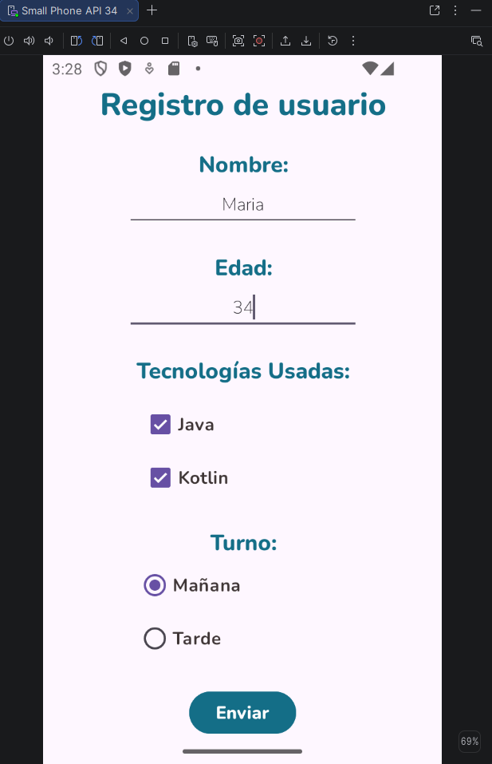
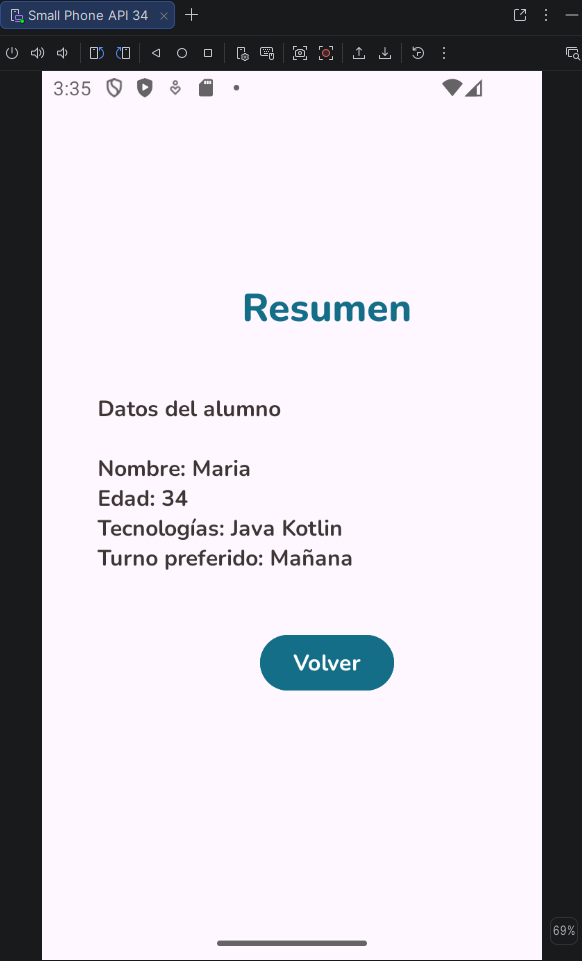

# Form Android

Android registration app built with **Kotlin** in **Android Studio** with the use of **XML**

The user fills in a form with their name, age, the technologies they want to learn and their preferred shift, and after tapping a button a second screen will show a summary of the data, through a clean two-screen interface.

## Why

> Kotlin project developed in Android Studio to practice:
>
> - Building an app with **two Activities** and **navigation between screens**
> - Designing the screens with **XML layouts**
> - Use of UI components: **TextView**, **EditText**, **CheckBox**, **RadioGroup**, **RadioButton** and **Button**
> - Linking the views to the code with **findViewById** and handling user interaction with **click listeners**
> - **Validating the user input** and showing feedback with the use of ***Toast***
> - Sending data between Activities with **Intent**, **putExtra** and **getStringExtra**
> - Organizing the code into methods: `initComponents()` and `setupListeners()`
> - **Version control** using Git and GitHub

## How it works

>### **Form** *MainActivity - First screen*
>
>Contains a title, two text fields (**name** and **age**), two checkboxes to choose the technologies (**Java** and **Kotlin**), a radio group to choose the shift (**morning** or **afternoon**) and the **Send** button.
>
>When the button is tapped, the app collects the data and checks that the name and age are not empty:
>
> - If one of them is empty, a ***Toast*** shows an error message and the user stays on the form
> - If everything is correct, the data is sent to the second screen through an **Intent**

>### **Result** *SecondaryActivity - Second screen*
>
>Receives the data with **getStringExtra** and displays the user's name, age, selected courses and chosen shift.
>
>The **Back** button closes the screen and returns the user to the form.

## Layout

### Form

### Result

